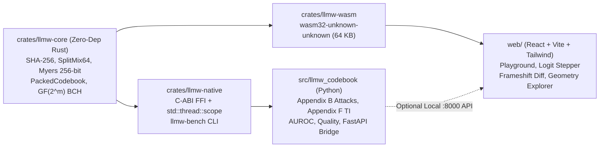

# Look It Up: Multi-bit LLM Watermarking via Codebook Search

[](https://github.com/ronaldgosso/look_it_up/actions/workflows/ci.yml)
[](https://github.com/ronaldgosso/look_it_up/actions/workflows/pages.yml)
[](LICENSE)
[](https://ronaldgosso.github.io/look_it_up/)

This repository implements "Look It Up: Multi-bit LLM Watermarking via Codebook Search" ([arXiv:2611.16890](https://arxiv.org/abs/2611.16890)) by Jarosław Janas, Paweł Morawiecki, and Josef Pieprzyk. It pairs a zero-dependency Rust core with Python bindings, a multi-threaded benchmark runner, and a browser studio compiled to WebAssembly.

Short generations around 127 to 200 tokens break most multi-bit watermarks. Position-allocation schemes decode fast, then collapse the moment a reader deletes one word and shifts every downstream token index. Exhaustive codebook search solves that frameshift through edit distance, but pure Python loops get too slow once payload capacity grows past a few bits. Codebook watermarking maps an `n`-bit watermark ID `W` to a longer `u`-bit codeword `L_W` through a secret affine linear code over GF(2), embeds bits via `+delta` logit biasing, checks re-tokenization invariance at every step, and looks up noisy outputs in Hamming or Levenshtein space. For wider payloads where exhaustive search hits scaling limits, shortened GF(2^m) BCH codes decode algebraically instead.

## How the Pieces Fit

All cryptographic primitives and search kernels live once in `crates/llmw-core`, then compile down two separate paths.



Inside `crates/llmw-core`, pure Rust handles FIPS 180-4 SHA-256 hashing, SplitMix64 balanced vocabulary splitting into `V0` and `V1`, hardware popcount Hamming search, and 256-bit Myers bit-parallel Levenshtein distance (`u128` fast path up to 128 bits and `[u64; 4]` limbs up to 256 bits). It also implements bit-packed codebooks with pairwise spread diagnostics and narrow-sense shortened GF(2^m) BCH codecs matching Table V in the paper.

`crates/llmw-native` wraps that core with `std::thread::scope` parallelism across CPU cores. Python loads it automatically over `ctypes` in [the native accelerator module](src/llmw_codebook/_rust_accel.py), while `llmw-bench` benchmarks million-entry lookups natively. The Python package in `src/llmw_codebook` implements Appendix B attacks, Appendix F stepwise tokenization-invariance rejection, Appendix G text quality evaluation, ROC/AUROC sweeps, and an optional FastAPI bridge on port 8000 for running local HuggingFace models.

On the frontend target, `crates/llmw-wasm` builds down to `64,001` bytes in `web/public/llmw_wasm.wasm`. That single WASM file powers the entire static studio in `web/` with zero backend costs. You get a token-by-token logit inspector, live 5% to 30% Appendix B attacks showing Hamming frameshifts next to Levenshtein alignment gaps, reproducible benchmark charts, linear vs. RNG distance spectra, and a Berlekamp-Massey BCH syndrome sandbox.

## Measured Benchmarks

Numbers below come from [benchmarks/SUMMARY.md](benchmarks/SUMMARY.md) (`n=12`, `u=127`, `delta=6.0`, 10% attack budget, 16 samples) and a native `llmw-bench` sweep on an 8-thread CPU.

| Measurement | Observed Result |
| --- | --- |
| Myers Levenshtein (`n=15`, 32,768 codewords, `u=127`) | 756.14 ms Python vs. 13.52 ms Rust (55.94x speedup) |
| Hamming search (`n=15`, 32,768 codewords, `u=127`) | 9.35 ms Python vs. 2.37 ms Rust (3.94x speedup) |
| One-million codebook (`n=20`, 1,048,576 codewords, `u=127`) | 3.73 ms Hamming, 609.09 ms Levenshtein, 0.096 ms BCH (`llmw-bench`) |
| Appendix B 10% word deletion recovery | 100.0% Levenshtein vs. 0.0% Hamming and 0.0% BCH |
| Appendix B synonym swaps, paraphrases, and insertions | 100.0% synonym, 100.0% paraphrase, 56.2% insertion (Levenshtein) |
| Zero-bit detection AUROC | 1.0000 with 100.0% TPR at 1% FPR |

## Running Locally

Build the Rust native library and WASM binary first, install the Python package, run tests, then build or serve the Vite studio.

```bash
# Rust tests, release cdylib, native 1M benchmark, and browser WASM build
cargo test --workspace
cargo build --release -p llmw-native
./target/release/llmw-bench
cargo build --target wasm32-unknown-unknown --release -p llmw-wasm

# Python package, differential parity checks, and full benchmark suite
pip install -e ".[dev,api]"
pytest -v
python scripts/run_benchmarks.py -n 12 -u 127 --samples-per-prompt 2

# Sync static web assets and start the client studio
python scripts/export_web_assets.py
cd web
npm install
npm run test
npm run build
npm run dev

# Optional local FastAPI bridge for real HuggingFace models
uvicorn llmw_codebook.api:app --port 8000 --reload
```

## Repository Layout

| Path | Purpose |
| --- | --- |
| [CI workflow](.github/workflows/ci.yml) | Runs Cargo tests, pytest parity checks, Vitest, and Vite production builds |
| [Pages workflow](.github/workflows/pages.yml) | Compiles `llmw_wasm.wasm` and deploys `web/dist` to GitHub Pages |
| [Cargo workspace](Cargo.toml) | Defines `llmw-core`, `llmw-native`, and `llmw-wasm` crates |
| [Python package](src/llmw_codebook/__init__.py) | Pure-Python reference engine, ctypes accelerator, attacks, metrics, CLI, and API |
| [Test suite](tests/test_phase2.py) | Bit-exact Rust vs. Python differential tests, codec checks, and API tests |
| [Benchmarks](benchmarks/SUMMARY.md) | JSON and Markdown benchmark artifacts generated by `scripts/run_benchmarks.py` |
| [Asset exporter](scripts/export_web_assets.py) | Copies N-gram weights, attack lexicons, WASM binary, and results into `web/` |
| [Web Studio](web/README.md) | React + TypeScript + Tailwind v4 client running on GitHub Pages |
| [Roadmap](docs/ROADMAP.md) | Five-phase build record and PR history |
| [Portfolio kit](docs/PORTFOLIO_SHOWCASE.md) | Deployment notes, resume copy, LinkedIn posts, demo script, and interview notes |
| [Dev.to article](docs/devto_article.md) | Interactive article draft with cover art and screenshots in `docs/assets/devto/` |
| [Reference paper](papers/README.md) | Citation details and download command for `arXiv:2611.16890` |
| [License](LICENSE) | GNU General Public License v3 |
