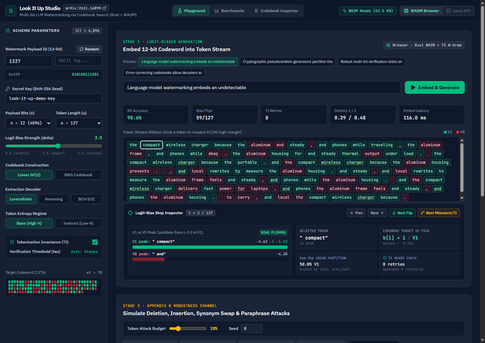
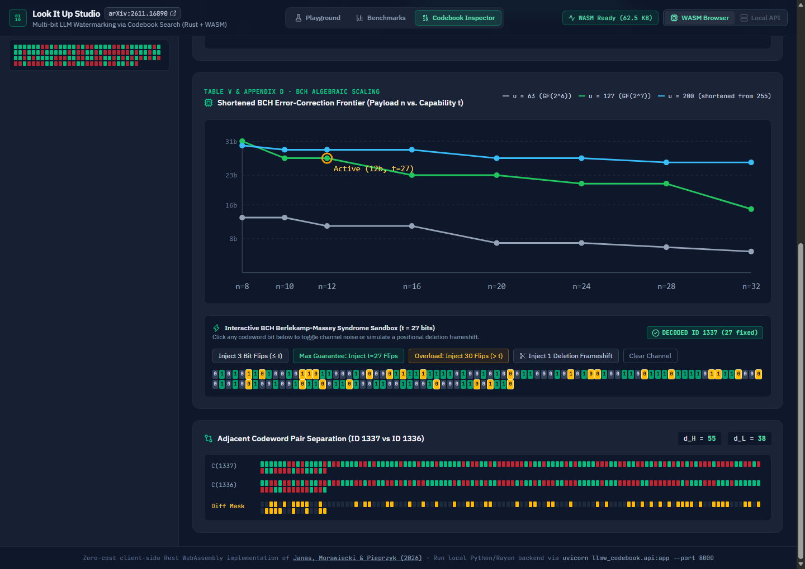

Most multi-bit LLM watermarks force an uncomfortable compromise once a generation is only ~127 tokens long:

1. **Position-allocation / error-correcting schemes** decode fast, yet a tiny word deletion creates a **positional frameshift** that scrambles every subsequent bit index.
2. **Naive exhaustive codebook search** can use edit distance to survive deletions, yet Python loops quickly stall as the payload grows to thousands or millions of codewords.

After implementing **"Look It Up: Multi-bit LLM Watermarking via Codebook Search"** ([arXiv:2611.16890](https://arxiv.org/abs/2611.16890)) from scratch, I compiled the core mathematics **once in zero-dependency Rust** and deployed it across two targets:

- A multi-threaded native C-ABI engine for Python (**`55.94x` faster** Levenshtein codebook search, scaling to **1,048,576 codewords** in `358.85 ms`)
- A **`64,001`-byte WebAssembly module** running an interactive browser Studio at **$0 server cost**

> **Try it live in your browser ($0 backend):** [**Look It Up Interactive WASM Studio**](https://ronaldgosso.github.io/look_it_up/)



---

## How Codebook Watermarking Works (In 60 Seconds)

Instead of encoding raw payload bits directly into sequential token positions, **Look It Up** maps an $n$-bit watermark ID $W \in \{0, \dots, 2^n - 1\}$ into a stretched $u$-bit binary codeword $L_W \in \{0, 1\}^u$ (for example, $n = 12$ bits inside $u = 127$ tokens):

1. **Secret Codeword Generation:** Using a keyed affine linear generator matrix over $\mathrm{GF}(2)$, $L_W = W \cdot G \oplus r$, every codeword is guaranteed strong pairwise Hamming separation and uniform neighborhood geometry.
2. **Cryptographic Vocabulary Partitioning:** At generation step $t$, we derive a seed from `SHA-256(secret_key || prev_token_id)` and split the vocabulary cleanly in half into $V_0$ and $V_1$.
3. **Logit Biasing + Tokenization Invariance:** If codeword bit $L_W[t] = 1$, every token in $V_1$ receives a $+ \delta$ logit boost; if $0$, every token in $V_0$ gets $+\delta$. Before committing token $t$, Appendix F's Tokenization-Invariance (TI) check verifies that re-tokenizing the decoded UTF-8 string yields the exact same token sequence so prefix merges never desynchronize the verifier.
4. **Extraction by Codebook Search:** Given suspect text, the verifier re-extracts a noisy bitstream $y$ and looks up $\arg\min_W d(y, L_W)$ under Hamming distance, bit-parallel Levenshtein edit distance, or shortened $\mathrm{GF}(2^m)$ BCH syndrome decoding.



In the interactive **Logit-Bias Step Inspector** above (`n = 12`, `u = 127`, `delta = 3.5`), stepping through `t = 2 / 127` shows the exact competition race: candidate token `" compact"` in $V_1$ trailed `" and"` in $V_0$ (`-4.62` vs `-4.30`), and adding `+3.5` pushed $V_1$ up to `-1.12` (`BIAS FLIPPED`) while keeping the seeded vocabulary split at `50.0% V1`.

---

## Interactive Challenge #1: What Happens When Someone Deletes 10% of the Words?

Suppose you watermark `ID = 1337` into 127 tokens, then delete 10% of the words at random (~12 tokens). **Before opening the toggle below, predict what each decoder returns:**

{% details Reveal Live WASM Frameshift Showdown (10% Word Deletion) %}

Deleting even a few words shifts every downstream bit index left (`t -> t - 1`, `t -> t - 2`, ...), shrinking our 127-token candidate sequence down to `114` bits.

- **Positional decoders collapse:** Hamming (`d_H`) misidentifies **`ID 2073`** at distance `44` (`margin +1`), and Shortened BCH (`GF(2^7)`) misidentifies **`ID 2967`** at distance `58` because fixed index alignment broke after the first deleted word.
- **Myers Levenshtein (`d_L`) recovers `ID 1337` cleanly:** bit-parallel edit distance inserts `+` gap slots (`= 104 · S 10 · + 13`) in the Two-Track Edit Alignment trace where extracted bits went missing, aligning all downstream bits cleanly at `d_L = 23` with a strong **`+8` margin** over the runner-up codeword (`31`).

Across the automated **Appendix B 10% Deletion Benchmark** (`n = 12`, `u = 127`), **Levenshtein hits `100.0%` recovery while Hamming and BCH drop to `0.0%`**:




---

## Making Exhaustive Search 55.94x Faster in Zero-Dependency Rust

To make nearest-neighbor search practical at interactive speeds in both Python and WebAssembly, `crates/llmw-core` replaces dynamic-programming arrays with **256-bit bit-parallel Myers edit distance** paired with **triangle-inequality popcount pruning**:

- Store every $u$-bit codeword in packed `u64` limbs (`u128` single-register fast path when $u \le 128$, 4-limb `[u64; 4]` when $u \le 256$).
- Prune any candidate codeword early whenever its Hamming weight difference $|\mathrm{wt}(c_i) - \mathrm{wt}(y)|$ already exceeds the current runner-up distance.
- Shard the codebook across all CPU cores with `std::thread::scope` for native Python/CLI execution while exporting an identical single-threaded C-ABI to `llmw_wasm.wasm` (`64,001` bytes).

| Benchmark (`u = 127`) | Python / NumPy | Rust Native | Result |
| --- | ---: | ---: | --- |
| Hamming (`n = 15`, 32,768 codewords) | 9.35 ms | **2.37 ms** | **3.94x speedup** |
| Myers Levenshtein (`n = 15`, 32,768 codewords) | 756.14 ms | **13.52 ms** | **55.94x speedup** |
| 1M-Codeword Sweep (`n = 20`, 1,048,576 entries) | — | **2.55 ms** (Hamming) / **358.85 ms** (Levenshtein) / **0.027 ms** (BCH) | Exact recovery |


---

## Interactive Challenge #2: Linear GF(2) vs. RNG Codebooks

If you need $2^{12} = 4,096$ binary codewords, why construct them via a secret linear generator matrix $W \cdot G \oplus r$ instead of seeding `SHA-256(key || W)` per ID?



In an unstructured **RNG codebook**, random collisions pull certain unlucky pairs much closer together (`NN range [38 .. 47] bits`, spread = `9 bits` at `n = 12, u = 127`).

In an affine **Linear $\mathrm{GF}(2)$ codebook**, every codeword $c_i$ has identical neighborhood geometry (`NN range [43 .. 43] bits` — **ZERO SPREAD**), beating the Gilbert–Varshamov baseline `d_GV = 40` consistently across all 4,096 IDs:




---

## Interactive Challenge #3: Scaling Beyond Exhaustive Search with Shortened BCH

Linear search is instant up to $n \approx 16$–$20$ bits, while larger payloads ($n = 24$ or $32$ bits, up to 4.29 billion IDs) outgrow brute-force iteration. For those regimes, **shortened binary BCH codes over $\mathrm{GF}(2^m)$** decode via algebraic Berlekamp–Massey + Chien search in **`0.027 ms`**.

With `n = 12, u = 127`, shortened $\mathrm{GF}(2^7)$ BCH guarantees correcting **`t = 27` random bit flips (`21.3%`)**. Try guessing what fails inside the **BCH Berlekamp–Massey Syndrome Sandbox** below:

- **Condition A:** Flip **27 bits** (`t = 27`) at arbitrary indices across the codeword.
- **Condition B:** Flip **0 bits**, but delete **1 bit** cleanly in the middle.



- **Condition A (`27` bit flips):** Berlekamp–Massey reconstructs the exact error-locator polynomial in microseconds and returns **`DECODED ID 1337 (27 fixed)`**.
- **Condition B (`1` deletion frameshift):** Just like positional Hamming lookup, syndrome arithmetic operates over fixed finite-field exponents $\alpha^0 \dots \alpha^{u-1}$, so a single unaligned deletion causes immediate **frameshift desync** unless paired with Levenshtein codebook alignment.





---

## Try Running Everything Locally (Python + Rust + Browser WASM)

Want to inspect the 55x speedup on real HuggingFace GPT/Llama models via the FastAPI bridge or hack on the Myers bit-parallel kernel yourself? Everything is MIT/GPLv3 clean and reproducible:

```bash
git clone https://github.com/ronaldgosso/look_it_up.git
cd look_it_up

# 1. Run Rust unit tests & 1M-codeword native benchmark
cargo test --workspace
cargo build --release -p llmw-native
./target/release/llmw-bench

# 2. Run Python + FastAPI + Rust FFI differential parity tests
pip install -e ".[dev,api]"
pytest -v

# 3. Launch the Interactive WebAssembly Studio locally
cd web && npm install && npm run test && npm run dev
```

Or explore the pre-built **$0 static browser lab** directly here: [**ronaldgosso.github.io/look_it_up**](https://ronaldgosso.github.io/look_it_up/)

---

*Built cleanly in 5 milestone phases with full CI/CD on GitHub Actions. If you enjoyed digging into bit-parallel edit distance, algebraic BCH shortening, and browser WebAssembly systems engineering, drop a bookmark or a star on [`ronaldgosso/look_it_up`](https://github.com/ronaldgosso/look_it_up)!*
