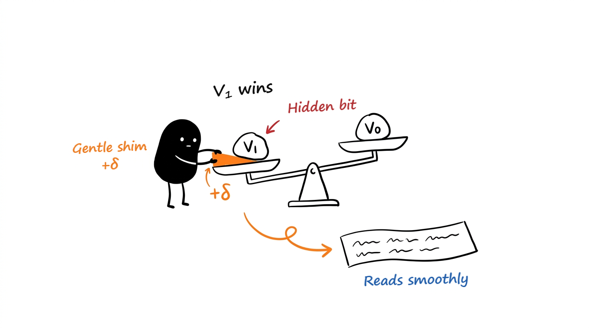
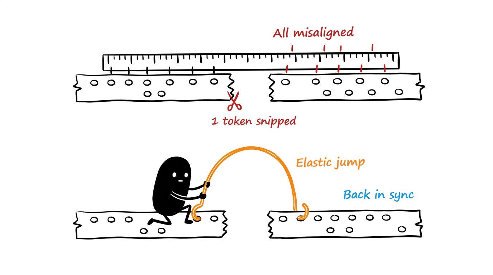
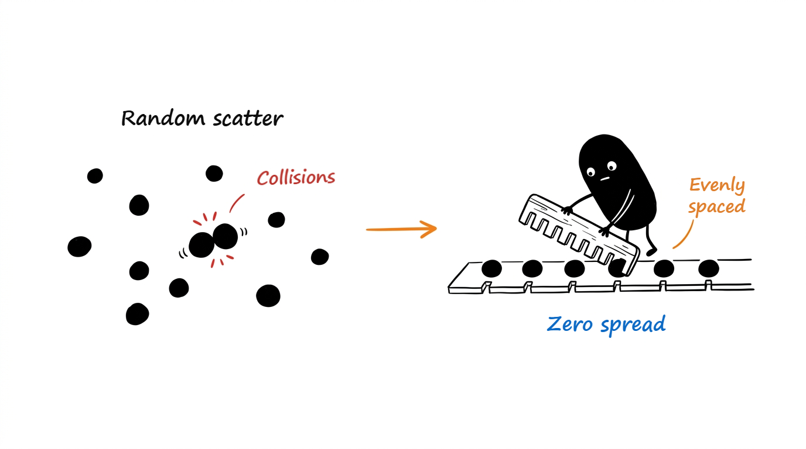

# Look It Up: Step-by-Step Visual Tutorial

This tutorial walks through how **Look It Up** (`arXiv:2611.16890`) hides multi-bit payloads inside language model generations and verifies them even after readers edit or delete words. For the 24-second narrated-free walkthrough video with soothing 75 BPM ambient scoring, open [brag.mp4](../brag-output/brag.mp4) (poster frame at [brag.jpg](../brag-output/brag.jpg)).

---

## Step 1: Partition the Vocabulary & Nudge Green Tokens (`+δ`)

Every generation step splits the language model vocabulary into two balanced pseudorandom halves — `V0` and `V1` — seeded by a cryptographic hash of the running prefix and secret key. Given target bit `b[i]` from the expanded codeword `L_W`, the embedder adds a soft constant bias `+δ` (`delta`) to candidate tokens belonging to `V_{b[i]}`.



When logits in `V0` and `V1` are close, `+δ` tips the chosen token onto the target partition (`BIAS FLIPPED` inside [TokenLogitInspector.tsx](../web/src/components/TokenLogitInspector.tsx)) while fluent top-choice tokens keep the sentence natural.

**Try it interactively:**
1. Open the Playground tab in Look It Up Studio (`cd web && npm run dev`).
2. Keep defaults (`n = 12`, `u = 127`, Watermark ID `1337`) or adjust `delta`.
3. Click **Embed** and inspect individual steps via **Prev**, **Next**, and **Next Flip**.

---

## Step 2: Survive Word Deletions via Elastic Edit Alignment

Position-dependent decoders (such as fixed-index Hamming `d_H` or algebraic syndrome BCH) align output bit `i` strictly to token index `i`. Delete just 10% of the words in the middle of a passage and every remaining bit shifts left — turning recovery rates to `0.0%`.



Look It Up replaces fixed indexing with Myers bit-parallel Levenshtein distance (`d_L`) across `u128` (and `[u64; 4]` limbs up to 256 bits) in `crates/llmw-core`, pairing insertions and deletions cleanly so every downstream bit realigns (`100.0%` match rate vs `0.0%` positional Hamming/BCH at `n = 12, u = 127`, 10% word deletion budget).

**Watch it recover in Studio:**
1. Click **Word Deletion** at `10%` attack budget.
2. Compare the **Dual-Decoder Comparison** cards inside [AlignmentFrameshiftPanel.tsx](../web/src/components/AlignmentFrameshiftPanel.tsx): positional Hamming breaks while Myers Levenshtein flags `FRAMESHIFT RECOVERED`.
3. Inspect red `-` (deleted codebit) and blue `+` (inserted gap) columns in the Two-Track Sequence Edit Alignment viewer.

---

## Step 3: Space Codewords Uniformly with Linear GF(2) + Rust Speed

If codewords are sampled purely at random, some pairs land awkwardly close together and collide under moderate noise. Look It Up builds codebooks from affine linear codes over `GF(2)` so every distinct message holds identical nearest-neighbor separation (`Zero Spread [43..43]` at `n = 12, u = 127`, compared against `[38..47]` under RNG sampling), while shortened `GF(2^m)` BCH codes (`t = 27`) provide an algebraic alternative at larger bit widths.



Exhaustive Levenshtein lookup over `n = 15` (`32,768` codewords, `u = 127`) drops from `756.14 ms` in Python to `13.52 ms` in parallel Rust (`55.94x` speedup via `crates/llmw-native` using `std::thread::scope`), and compiles down to a `64,001`-byte `llmw_wasm.wasm` binary so browser verification needs zero backend calls.

**Explore the codebook geometry:**
1. Switch to **Codebook Inspector** ([InspectorView.tsx](../web/src/components/InspectorView.tsx)).
2. Compare the green Linear GF(2) bar against the blue RNG curve in [DistanceSpectrumChart.tsx](../web/src/components/DistanceSpectrumChart.tsx).
3. Switch to **Benchmarks** to inspect measured Appendix B recovery tables and zero-bit AUROC (`1.0000`).

---

## Quickstart Commands

```bash
# 1. Build and benchmark native Rust core + generate 64 KB WebAssembly studio binary
cargo test --workspace
cargo build --release -p llmw-native
./target/release/llmw-bench
cargo build --target wasm32-unknown-unknown --release -p llmw-wasm

# 2. Export web assets and start Look It Up Studio locally (offline WASM mode)
python scripts/export_web_assets.py
cd web && npm install && npm run dev
```

For full architecture notes, API bridge setup, and paper citation details, see the root [README.md](../README.md) and [brand guidelines](assets/brand/brand-guidelines.md).
